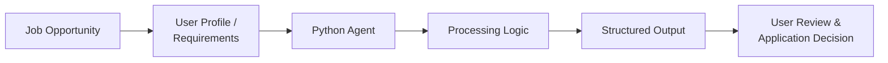

<div align="center">

# 🤖 Job Apply Agent

**An intelligent Python automation project for organizing and streamlining job-search workflows.**


[](docs/PRESENTATION.html)
[](docs/PROJECT_REQUIREMENTS.md)
[](docs/PROJECT_PRESENTATION.md)

</div>

---

## 🚀 Overview

**Job Apply Agent** is a Python-based AI automation project designed to reduce repetitive job-search and application-management work.

Instead of manually handling every job opportunity, requirement, and application status, this project provides a structured automation workflow that can be extended into a more intelligent career-assistant system.

> **Goal:** Help job seekers spend less time on repetitive tasks and more time on skill development, interview preparation, and career growth.

---

## 🎯 Problem It Solves

Job seekers often manage multiple opportunities across different platforms. This creates repetitive work:

- Searching and reviewing job listings
- Comparing job requirements with personal skills
- Tracking applications and follow-ups
- Maintaining application status across opportunities
- Repeating similar career-workflow tasks manually

**Job Apply Agent** provides a structured foundation to automate and organize these workflows responsibly.

---

## 🧠 How It Works



The project follows a modular, extensible approach: job-related input is processed through a Python automation workflow and converted into organized output for user review.

---

## ✨ Key Highlights

| Area | Description |
|---|---|
| 🤖 AI Automation | Built around practical automation and agent-workflow concepts |
| 🐍 Python First | Simple, readable, and extensible Python-based design |
| 🗂️ Structured Workflow | Organizes job-related information for easier decision-making |
| 🔒 Responsible Automation | Designed for user-reviewed workflows, not unsafe automatic actions |
| 📈 Extensible | Ready for future AI, matching, tracking, and reporting features |
| 📚 Documentation | Includes interactive presentation, requirements, and project walkthrough |

---

## 🛠️ Technology Stack

<div align="center">


</div>

---

## ⚙️ Getting Started

### 1. Clone the repository

```bash
git clone https://github.com/AnyalstRushi/job_apply_agent.git
cd job_apply_agent
```

### 2. Install dependencies

```bash
pip install -r requirements.txt
```

### 3. Run the project

```bash
python main.py
```

---

## 📁 Project Structure

```text
job_apply_agent/
├── main.py                        # Main automation workflow
├── requirements.txt               # Project dependencies
├── README.md                      # Project documentation
├── docs/
│   ├── PRESENTATION.html          # Interactive project presentation
│   ├── PROJECT_REQUIREMENTS.md    # Business and functional requirements
│   └── PROJECT_PRESENTATION.md    # Slide-by-slide project walkthrough
└── .gitignore
```

---

## 🔮 Future Roadmap

- [ ] Job-description parsing and skill extraction  
- [ ] Resume-to-job match scoring  
- [ ] Application-status dashboard  
- [ ] Interview-question suggestions  
- [ ] Integration with approved job boards and productivity tools  
- [ ] AI-generated application summaries with user review  

---

## 📑 Project Documents

| Document | Description |
|---|---|
| [📊 Interactive Presentation](docs/PRESENTATION.html) | Visual project presentation |
| [📝 Project Requirements](docs/PROJECT_REQUIREMENTS.md) | Business, functional, and workflow requirements |
| [🎯 Project Presentation](docs/PROJECT_PRESENTATION.md) | Slide-by-slide project walkthrough |

---

## 🤝 Contributing

Suggestions, improvements, and feature ideas are welcome. Please open an issue before submitting major changes.

---

## 📫 Connect

<div align="center">

**Rushi Wavhal**  
[GitHub](https://github.com/AnyalstRushi) • rushiwavhal33@gmail.com

⭐ If you find this project useful, consider starring the repository.

</div>
